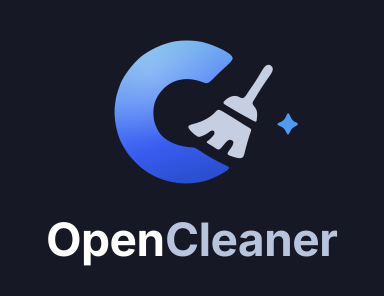
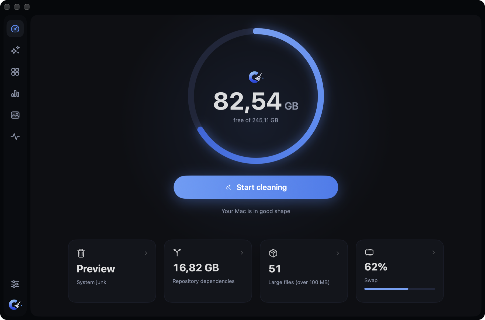
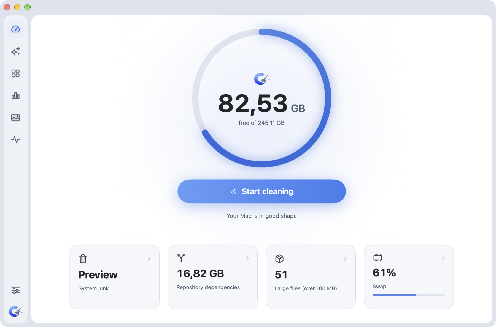
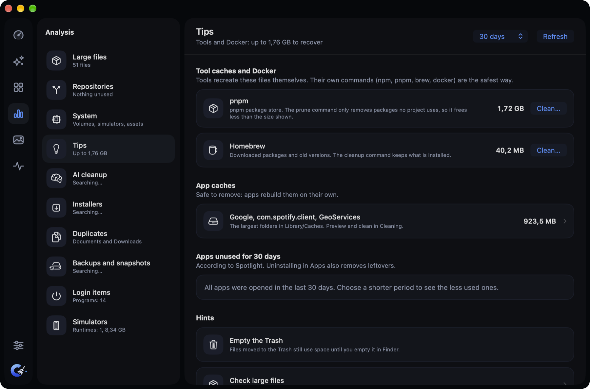
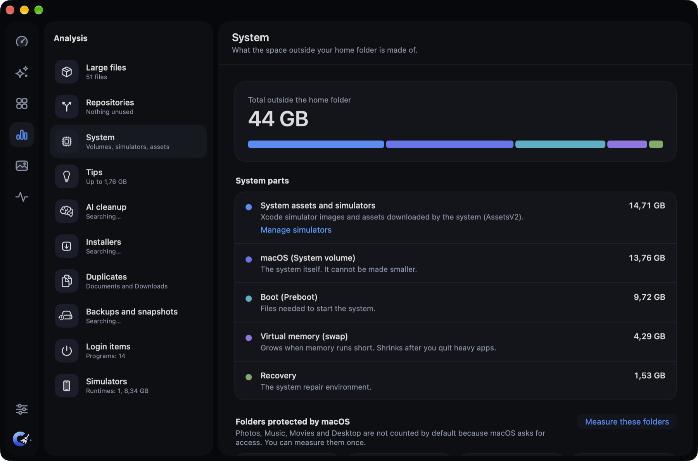
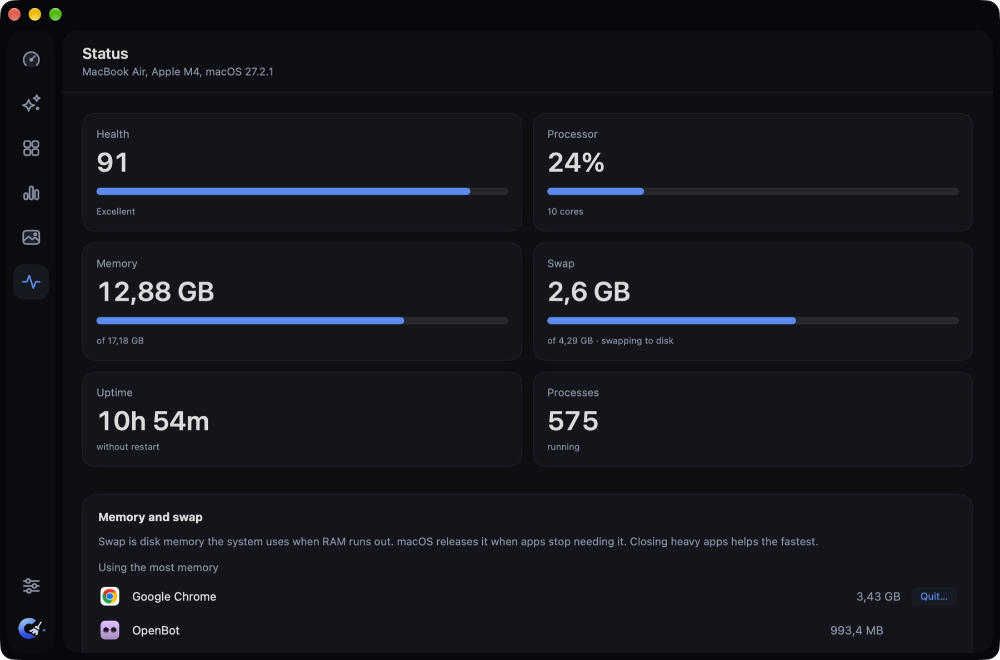
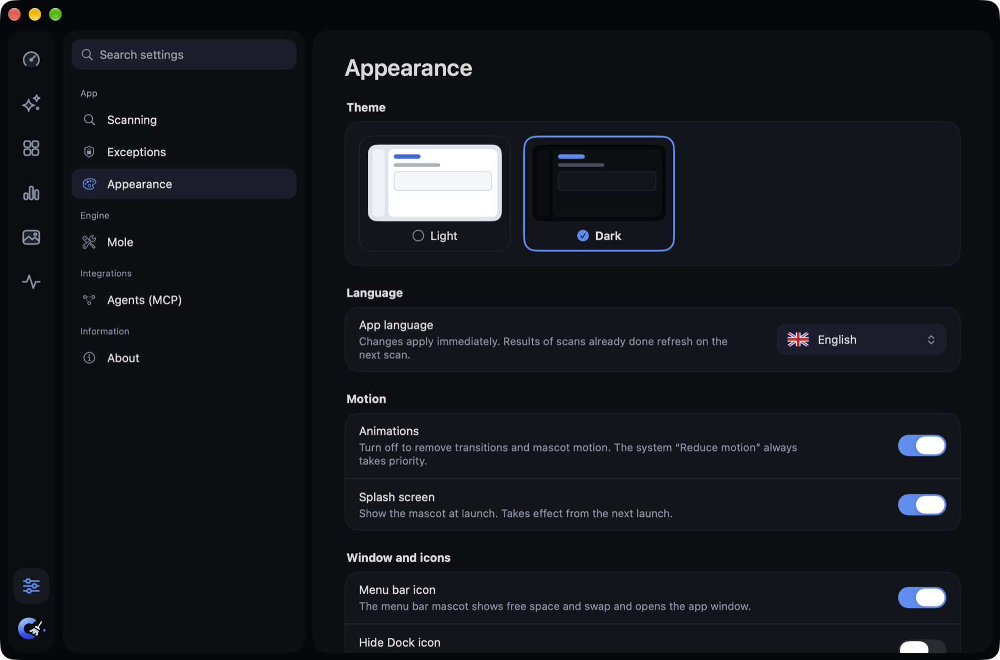
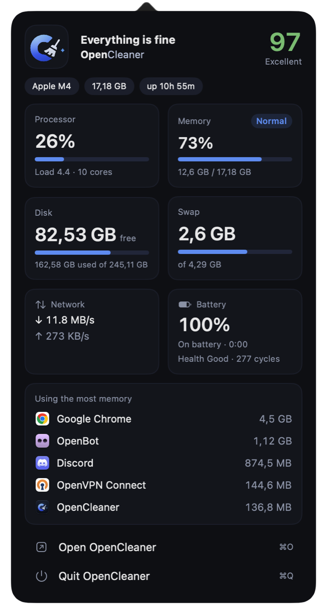

<p align="center">
  
</p>

<p align="center">
  A native, dark, fast Mac cleaner. Preview first, delete only after you confirm.
</p>

<p align="center">
  <a href="LICENSE"></a>
  
  
  
  
  <a href="https://github.com/kczepiec/opencleaner/releases/latest"></a>
  <a href="CONTRIBUTING.md"></a>
</p>

---

OpenCleaner is a SwiftUI app that wraps [Mole](https://mole.fit) (`mo`) and adds its own native scanners. It shows where your disk space went and gives you safe ways to get it back. It also ships an MCP server, so your AI agents can inspect (and, if you allow it, clean) your Mac.

## Screenshots

<p align="center">
  
  
</p>
<p align="center">
  
  
</p>
<p align="center">
  
  
</p>
<p align="center">
  
</p>

## Features

| Area | Powered by | What it does |
|---|---|---|
| **Dashboard** | native | Used and free space, breakdown by category, one-click cleaning with live progress, free space history chart |
| **Cleaning** | built-in engine, or `mo clean` / `mo optimize` | Dry-run preview, grouped results with sizes, then run after confirmation. Works without Mole |
| **Apps** | `mo uninstall` + native | App list; uninstalling also finds the leftovers in `~/Library` (all moved to the Trash) |
| **Photos** | PhotoKit | Screenshots, screen recordings, TikTok and other downloaded videos, messenger images, GIFs, large videos and duplicates in your Photos library. Removed items go to Recently Deleted |
| **Large files** | native | Files above a threshold (Library included), search, modified date, Finder and Trash per row |
| **Repositories** | native | `node_modules`, `.venv`, `target`, `.next` in repos with no git activity, moved to the Trash |
| **Tips** | native | Docker, npm, Yarn, pnpm, Homebrew, pip, uv, Bun, Cargo, Gradle, CocoaPods, Xcode caches, app caches and apps you have not opened for a while |
| **AI cleanup** | native | Caches, old versions and old or orphaned sessions of Claude Code, Codex, Cursor, Claude Desktop and Gemini |
| **Duplicates** | native | Identical files (SHA-256) or photos in your Pictures folder, oldest copy stays |
| **Installers, backups** | native | Old `.dmg`/`.pkg`/`.iso`/archives in Downloads, iOS device backups and Time Machine snapshots |
| **Login items** | native | Programs that start at login, with removal |
| **Simulators** | `xcrun simctl` | Xcode runtimes, unavailable simulators and per-device sizes, with safe deletion |
| **Status** | `mo status` | Health, CPU, memory and swap, heavy apps; menu bar panel with network and battery |
| **Exceptions** | native | Folders and files that are never offered for deletion |
| **MCP server** | built in | `opencleaner-mcp` (English) for Claude Code, OpenBot and other agents |
| **Languages, themes** | native | Polish and English, light and dark |
| **Auto update** | GitHub Releases | Daily check, one click to install and relaunch |

## Install

Download `OpenCleaner-<version>.zip` from [Releases](https://github.com/kczepiec/opencleaner/releases/latest), unzip it and move `OpenCleaner.app` to `~/Applications`.

The app is ad hoc signed, so on first launch right-click it and choose **Open**. Or build from source:

```sh
brew install xcodegen
tools/install.sh        # builds, copies to ~/Applications, installs Mole if missing
```

If `mo` is not installed, the app offers to install it with Homebrew.

## Safety first

- `mo clean` and `mo optimize` **delete permanently**, bypassing the Trash. OpenCleaner always runs a preview first and asks before it deletes anything.
- Repositories and unused artifacts go to the Trash, and only git-ignored folders next to a project manifest are touched.
- Tool caches are cleaned with the tool's own command (`npm cache clean`, `pnpm store prune`, `docker system prune`, ...) after you confirm the exact command.
- The MCP tools that change the disk (`clean_run`, `optimize_run`) are off by default and need `confirm: true`.

## MCP server for agents

`opencleaner-mcp` is a JSON-RPC server over stdio, embedded in the app. Install it from **Settings, Agents (MCP)**, which can also register it in Claude Code (`claude mcp add`), copy the config for other clients and install a `SKILL.md`.

Read-only tools: `disk_usage`, `memory_status`, `clean_preview`, `optimize_preview`, `list_apps`, `uninstall_preview`, `system_breakdown`, `find_unused_repos`, `large_files`.

## Build from source

Requirements: macOS 14+, Xcode, [XcodeGen](https://github.com/yonaskolb/XcodeGen).

```sh
swift test                      # logic and parsers (CleanKit)
xcodegen generate
xcodebuild -project OpenCleaner.xcodeproj -scheme OpenCleaner \
  -configuration Release -derivedDataPath build CODE_SIGN_IDENTITY=- build
```

Layout: `App/` SwiftUI app, `Sources/CleanKit` scanning and parsing (no UI, unit tested), `Sources/opencleaner-mcp` MCP server, `Branding/` logo, `tools/` install and release scripts.

## Releasing

```sh
tools/release.sh 1.1            # writes dist/OpenCleaner-1.1.zip
gh release create v1.1 dist/OpenCleaner-1.1.zip --generate-notes
```

Installed apps pick the release up automatically.

## Contributing

Issues and pull requests are welcome. Read [CONTRIBUTING.md](CONTRIBUTING.md) and the [Code of Conduct](CODE_OF_CONDUCT.md) first. Security problems: see [SECURITY.md](SECURITY.md).

## License

[MIT](LICENSE). Mole is a separate project with its own license.
